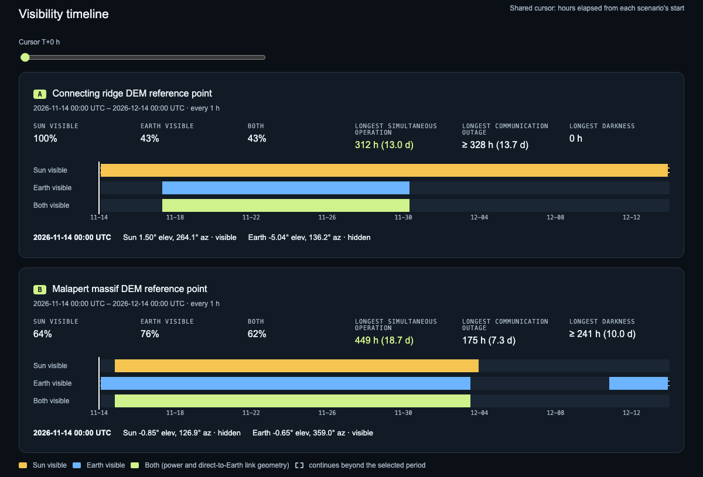

# LunarWindow - Lunar Landing Site Navigator

Our entry for the [NASA Space Apps 2026 challenge](https://www.spaceappschallenge.org/2026/challenges/lunar-landing-site-navigator/) "Lunar Landing Site Navigator".

LunarWindow compares lunar south-pole sites and dates. For each one it shows when the Sun is up (power), when Earth is up (direct-to-Earth link), and when both are. It runs entirely on archived, checksummed NASA data: JPL Horizons ephemerides and LOLA elevation models. A Python/FastAPI backend serves the calculations, and a Next.js/React app shows a three-lane timeline with a shared cursor, a mission window finder, and a 2D sky explorer.



|              |                                                                                          |
| ------------ | ---------------------------------------------------------------------------------------- |
| Run it       | `docker compose up --build -d --wait`, then open [localhost:3000](http://localhost:3000) |
| Deploy       | Render (API) + Vercel (web): [docs/deploy.md](docs/deploy.md)                            |
| Demo         | [docs/demo-script.md](docs/demo-script.md), [screenshots](docs/screenshots/)             |
| Data sources | [docs/attribution.md](docs/attribution.md)                                               |
| License      | [MIT](LICENSE) for code; data keeps its providers' terms                                 |

**Scientific limits.**

- Results use a flat 0° horizon unless a scenario selects the reviewed LOLA terrain horizon. Eclipses, power and radio-link performance are not modelled.
- Event times are bracketed by the sampling interval.
- Reference points are DEM grid cells, not landing recommendations.
- The terrain horizon exists for one site (Site01, 0 m observer) and requires accepting a documented frame approximation; other curated horizons are preliminary.
- The QuickMap comparisons validate Sun/Earth angles for observers about 100–144 km up, not ground-level terrain shadows.

## Start with Docker

The [mission experience](docs/mission-experience.md) combines the cinematic interface with Mihai's animated **Lander view**, the polar sky dome, coordinate map, verified terrain controls, and mission-shift comparison. Both playback controls drive one shared timeline and pause when inputs change.

With Docker running, the team can start the web app without installing Node.js or Python:

```sh
docker compose up --build -d --wait
```

Open [localhost:3000](http://localhost:3000) for the UI and [localhost:8000/docs](http://localhost:8000/docs) for the FastAPI demo API. Run the ephemeris tool separately:

```sh
docker compose run --build --rm ephemeris \
  --sites data/sites.example.json \
  --start 2026-11-14T00:00:00Z --end 2026-11-15T00:00:00Z
```

Exports and caches persist in `./data`. See [Docker instructions](docs/docker.md) for tests, Linux file ownership, port configuration, and image-only commands. FastAPI serves synthetic demos and geometric or reviewed Site01 terrain evaluations of archived ephemerides. Docker ships a verified, read-only [demo data release](docs/data-releases.md) covering four default full-month jobs; valid misses calculate normally, with no live NASA requests.

## Native setup: Backend/data

The backend serves verified reference evaluations, visibility metrics/windows, and reviewed Site01 terrain, with memory caching and versioned offline data releases:

```sh
python3 -m venv .venv
source .venv/bin/activate
python -m pip install -e './backend[dev]'
python -m uvicorn lunarwindow.api.app:app --reload --port 8000
```

Additional sites use the [reviewed terrain handoff workflow](docs/terrain-coverage.md), including an offline candidate checker and verification of every registered mask in CI and API image builds. Reviewed Site04/Site23 masks are still needed before enabling terrain for those points.

The opt-in [custom-coordinate API](docs/custom-coordinate-evaluation.md) evaluates an explicit observer using live Horizons acquisition, bounded raw archival/reuse, and the existing metrics/windows engine. Geometric mode requires caller-supplied ground elevation; terrain mode derives it from configured LOLA DEMs and labels generated masks preliminary. The reference demo stays offline by default.

Open [localhost:8000/docs](http://localhost:8000/docs). `POST /api/evaluations` serves synthetic scenarios. `GET /api/reference/sites` lists verified reference points and available dates; `POST /api/reference/evaluations` calculates visibility, metrics, windows, and setting brackets from their archived NASA samples with an explicit geometric or reviewed Site01 terrain horizon. Optional `visibilityRule` and `asOfUtc` select the policy and countdown reference. See the [API contract](docs/backend-data.md) and [calculation model](docs/visibility.md) for request examples, source provenance, and precision limits.

## Native setup: Ephemeris lead

Python 3.11+; pip installs the declared contract-validation dependency. No NASA API key is required.

```sh
python3 -m venv .venv
source .venv/bin/activate
python -m pip install -e ./backend
lunarwindow-ephemeris --sites data/sites.example.json \
  --start 2026-11-14T00:00:00Z --end 2026-11-15T00:00:00Z
python -m unittest discover -s backend/tests -v
```

Each export creates `data/processed/ephemeris/<run-id>/` with JSON/CSV pairs and a checksum manifest. Raw response caches stay under `data/raw/horizons/`. The sample site is illustrative. See [Python setup](backend/README.md), [your work package](docs/ephemeris-lead.md), [libration notes](docs/libration.md), and [QuickMap validation protocol](docs/validation/quickmap.md).

## Native setup: Terrain/GIS lead

```sh
python -m pip install -e './backend[gis,analysis]'
lunarwindow-terrain download --all          # ~3.7 GB of NASA PGDA rasters into data/raw/lola/
lunarwindow-terrain horizons --plots \
  --sites data/sites.curated.json data/sites.shackleton-rim.json data/sites.artemis-regions.json
python scripts/export_terrain_mask.py --site-id lola-site01-reference   # validated demo mask
```

Horizon profiles (360 whole-degree values plus 3,600 rays) are computed by exact spherical ray casting over the 20 m and 120 m LOLA south polar DEMs, out to 200 km, with ground + 2 m mast observers. The one validated demo mask is `data/reference/terrain-masks/lola-site01-reference-mast-0m.json`: same coordinates and observer altitude as the archived Site01 ephemerides, 5 m/20 m/120 m DEM tiers, full DEM provenance. Horizons for the other 16 curated sites are preliminary. See [the terrain work package](docs/terrain-gis-lead.md) for sources, algorithm, validation, and handoff.

## Native setup: React UI

Use Node.js 22.12+ on the 22.x line, or Node.js 24.x, with npm. An `.nvmrc` is included for Node 22.

```sh
nvm install
nvm use
npm ci
npm run dev
```

Start the FastAPI service as well (see Backend/data above, or `docker compose up --build -d --wait api`), then open [localhost:3000](http://localhost:3000). The browser calls the API at `http://localhost:8000` by default; set `NEXT_PUBLIC_API_BASE_URL` at build time for another address (see `.env.example`). No API keys or database are required, and all data comes from the committed archive.

## What is ready

- Next.js App Router, React, and strict TypeScript.
- Responsive two-scenario workspace with editable coordinates, UTC dates, sample intervals, and validation.
- FastAPI skeleton with deterministic synthetic site/scenario data, HTTP validation, CORS, OpenAPI, and Docker startup.
- Verified reference-data loader, site catalog, date-range selection, and geometric evaluations with original NASA evidence and archive coverage.
- Reusable visibility engine with partial-disc rules, circular horizon interpolation, metrics, merged windows, clipped-range flags, and countdown brackets.
- Python Horizons client/CLI with sequential chunked requests, caching, JSON/CSV export, observer checks, and source provenance.
- Flat Sun/Earth series matching the team's JSON field names, with corresponding TypeScript types.
- Offline Python regression tests, shared request locks, retry handling, immutable run bundles, and JSON Schema/semantic handoff checks.
- A sourced 30-day, three-point NASA reference dataset, pointing plot, and reproducible QuickMap comparison evidence.
- A validated terrain horizon mask for the Site01 reference point (`lunarwindow.terrain-mask.v1`), plus tooling for a sourced 17-site catalog (9 Artemis III regions, Shackleton rim, landing sites, contrast cases) whose preliminary horizons match NASA PGDA 18.6-year sunlight averages within 4 percentage points at 12 of 14 polar sites.
- Web app on archived NASA data: two-scenario comparison of verified reference sites, an animated lander's-eye view (to-scale Sun and Earth on the real skyline, Earth's computed phase, playback driving the shared cursor), a three-lane Sun/Earth/both timeline with a shared cursor, longest simultaneous operation and communication-outage indicators, next sunset and Earthset countdowns bracketed by the sampling interval, a mission window finder, and a 2D azimuth/elevation sky explorer. Each scenario selects a flat 0° horizon or, for Site01, the reviewed LOLA terrain horizon after accepting its frame approximation. Loading, error, and stale-result states; the horizon model and data source are stated on the page for each scenario.
- Health endpoint at `GET /api/health`.
- ESLint, Prettier, Vitest, production build, and GitHub Actions checks.
- Challenge analysis, architecture, data-source notes, and an implementation roadmap.

The web app evaluates the verified reference sites through `POST /api/reference/evaluations`; it validates inputs locally, does not persist them, and maps and custom coordinates remain pending. The API calculates visibility and metrics from synthetic demos or verified archived ephemerides, with an explicit geometric or reviewed-terrain horizon mode. Terrain mode currently supports the Site01 0 m mask and requires acceptance of its frame approximation, in the API and in the web form; sampling, disc-model, and near-field limitations remain. A sourced 17-site GIS catalog is also available (see the [terrain work package](docs/terrain-gis-lead.md)); its other horizons are preliminary and are not registered for reference API evaluations. The reference catalog contains sourced DEM grid cells, not approved landing targets. Three QuickMap camera-observer comparisons pass at display precision; they validate displayed Sun/Earth angles for observers about 100–144 km above the surface, not terrain shadows seen by a lander on the ground. See [the validation report](docs/validation/report.md).

## Structure

```text
.github/workflows/ci.yml       Automated checks
backend/
  pyproject.toml              Installable Python package and CLI
  src/lunarwindow/api/        FastAPI app, contracts, demo and reference providers
  src/lunarwindow/ephemeris/  Models, Horizons client/parser, export CLI
  src/lunarwindow/visibility/ Visibility engine, metrics, windows, and contracts
  src/lunarwindow/precompute/ Offline bundles, replay, release tools, and lookup
  src/lunarwindow/terrain/    LOLA downloads, horizon ray casting, site catalog, service
  tests/                     Offline tests and archived NASA fixtures
data/
  sites.example.json          Illustrative input catalog
  raw/                        Downloaded source data (ignored)
  processed/                  Derived data (ignored)
  releases/                   Versioned demo release, pinned plan, and checksums
  README.md                   Provenance and storage conventions
docs/
  challenge.md                Requirements mapped from the NASA brief
  architecture.md             Module boundaries and API direction
  data-sources.md              NASA references and coordinate conventions
  roadmap.md                  Suggested implementation sequence
scripts/                      Reference-point, QuickMap, rim-band, and terrain validation tools
src/
  app/
    api/health/route.ts        Working health endpoint
    layout.tsx                Application metadata and root layout
    page.tsx                  Landing page, sources, and limits
    globals.css               Base styling
  domain/
    scenario.ts               Input schemas and shared types
    ephemeris.ts              Team-aligned Python export types
    horizon.ts                Terrain horizon profile types
    evaluation.ts             FastAPI demo response types
  features/
    scenarios/components/     Editable comparison workspace
  server/
    providers/                Notes for optional frontend-side adapters
tests/                        Offline contract tests
```

## Commands

| Command                | Purpose                                           |
| ---------------------- | ------------------------------------------------- |
| `npm run dev`          | Run development server                            |
| `npm run build`        | Create production build                           |
| `npm start`            | Serve the production build                        |
| `npm run lint`         | Check code quality                                |
| `npm run typecheck`    | Generate Next.js route types and check TypeScript |
| `npm test`             | Run offline tests                                 |
| `npm run test:watch`   | Watch tests during development                    |
| `npm run format`       | Format source and documentation                   |
| `npm run format:check` | Check formatting                                  |
| `npm run check`        | Run lint, types, tests, and production build      |

## Next step

The [terrain-aware evaluation endpoint](docs/backend-data.md#terrain-aware-evaluation-contract) connects archived ephemerides and the reviewed Site01 mask to the visibility engine, with checksum verification, observer/frame checks, and complete provenance. Geometric v1 remains available; terrain v2 requires explicit acceptance of the frame approximation. [Dedicated regression tests](docs/validation/terrain-regression.md) cover terrain blocking and independently derived Site01 model baselines. Verified evaluations are cached, and the web app selects the terrain horizon per scenario. Next, review and register masks for further curated sites. See the [backend work package](docs/backend-data.md), [visibility model](docs/visibility.md), and [ephemeris handoff](docs/ephemeris-lead.md). The long 2026-2030 batch is supported by the CLI but has not been run.
