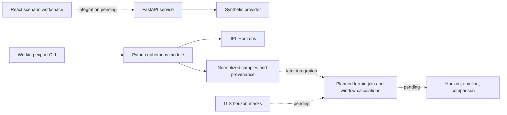

# Architecture

## Stack

The team plan separates Python/FastAPI data services from a React frontend. The existing frontend starter uses Next.js App Router and strict TypeScript. The Ephemeris lead's working package is under `backend/src/lunarwindow/ephemeris`; it is importable without invoking the CLI. Backend/data's first milestone adds the FastAPI app under `backend/src/lunarwindow/api`, with a synthetic provider for frontend development. No database is required at this stage.

Python uses FastAPI/Pydantic for HTTP contracts, Uvicorn for serving, the standard library for retrieval/storage, and JSON Schema for the ephemeris handoff boundary. Offline tests use `unittest` and FastAPI's HTTP test client. Matplotlib and Rasterio are optional analysis/acquisition extras. The frontend uses Zod for scenario validation, Vitest for tests, and ESLint/Prettier for code quality.

The package manifest overrides the TypeScript ESLint parser's `minimatch` dependency to patched version 11.0.8 or later in that major, addressing GHSA-g3hv-75wg-m249. Remove this override once upstream tooling depends on a patched release. ESLint stays on version 9 for compatibility with the React plugin's declared peer range.

## Boundaries

- `backend/src/lunarwindow/ephemeris`: P1 coordinate/time validation, Horizons query construction, strict parsing, source archives, and JSON/CSV export.
- `backend/src/lunarwindow/api`: P3 FastAPI routes, request/response models, errors, CORS, and a replaceable synthetic-data provider.
- `backend/tests`: offline Python tests and small archived NASA response fixtures.
- `src/app`: UI entry points, layouts, metadata, and the frontend health endpoint. Keep scientific calculations out of page and route files.
- `src/features`: user-facing workflows and components. The existing `scenarios` feature edits two independent configurations. Add `horizon`, `timeline`, `comparison`, and `sites` features as those views are built.
- `src/domain`: frontend types and schemas; `ephemeris.ts` mirrors the team's flat Python export contract and `evaluation.ts` describes the FastAPI demo responses.
- `src/server/providers`: reserved for an optional frontend proxy to the team backend; no active provider is configured.
- `data`: downloaded inputs and generated outputs. Keep source metadata and checksums; ignore bulky data by default.
- `scripts`: reproducible acquisition and preprocessing commands.
- `tests`: frontend scenario contract tests.

## Current behavior

The page runs independently of NASA services. Scenario fields are kept in React state and validated against `scenarioSchema`. The results panels are empty states. Reloading resets the scenarios. `GET /api/health` describes this frontend process and identifies its ephemeris provider as `not-configured`; it does not check the separate Python CLI.

FastAPI runs separately on port 8000, with its own `/api/health`, `/api/sites`, `/api/sites/{site_id}`, and `POST /api/evaluations`. All data responses identify the synthetic mode. Demo results include a 360-point horizon, time series, and illustrative visibility flags; metric fields remain null. The React workspace is not connected yet. See [the backend contract](backend-data.md).

The CLI can retrieve real Sun/Earth angles, cache exact provider responses, and export flat series plus provenance. A committed 30-day dataset covers three sourced NASA LOLA reference grid cells, including surface heights. QuickMap camera-observer comparisons and a pointing plot are documented in `docs/validation/report.md`. Team-approved mission coordinates, terrain masks, visibility flags, metrics, and the full multi-year dataset remain pending.

## Current data flow



The workspace, FastAPI demo service, Python ephemeris module, and export CLI exist today. The ephemeris output type is `EphemerisDataset` in `src/domain/ephemeris.ts`; demo evaluation responses use `EvaluationDataset` in `src/domain/evaluation.ts`. Dashed arrows describe work still pending.

## HTTP contract

FastAPI implements `POST /api/evaluations` using the existing UI `Scenario` request:

```json
{
  "name": "Scenario A",
  "location": {
    "latitudeDeg": -89,
    "longitudeDeg": 0,
    "altitudeKm": 0
  },
  "startUtc": "2026-11-14T00:00:00Z",
  "endUtc": "2026-11-15T00:00:00Z",
  "stepMinutes": 60
}
```

The current provider generates explicitly synthetic horizon/series data and returns the requested coordinates and sampling period. It shares `TimeRange` validation with P1 and returns structured input errors. Metrics remain null. Real-data integration must map the UI request to Python `Site` and `TimeRange`, preserve P1 provenance, and add GIS masks, visibility, and metrics. Never substitute generated data for a failed real-data request.

The Python client already bounds/chunks requests, uses timeouts and limited retries, checks response structure/observer coordinates, and reuses disk archives keyed by request URL. Cooperating workers now share OS request/cache locks, honor Retry-After, validate supported API signatures, and use atomic file writes. Export runs publish together with checksums only after all sites validate. The demo API validates HTTP inputs and bounds each request to 31 days / 10,000 samples. Before exposing real-data computation, backend still needs worker scheduling and cache retention limits. All workers must share the configured lock directory; blocking client calls belong in a worker.

## Build and hosting

`npm run build` creates the Next.js production output; `npm start` serves it on port 3000. `pip install -e ./backend` installs the Python package, API dependencies, and CLI. `python -m uvicorn lunarwindow.api.app:app --port 8000` starts FastAPI. Docker Compose starts both services and CI checks both health endpoints. Python tests run separately in CI. Connecting the frontend and real-data pipeline remains a later integration task.
