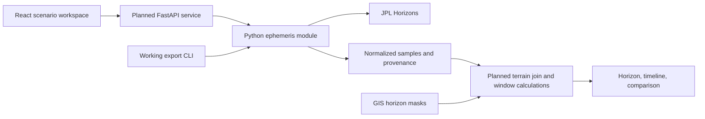

# Architecture

## Stack

The team plan separates Python/FastAPI data services from a React frontend. The existing frontend starter uses Next.js App Router and strict TypeScript. The Ephemeris lead's working package is under `backend/src/lunarwindow/ephemeris`; the Backend/data lead can import it into FastAPI without invoking the CLI. FastAPI routes themselves are not implemented here. No database is required at this stage.

Python uses the standard library at runtime, with `unittest` for offline tests. The frontend uses Zod for scenario validation, Vitest for tests, and ESLint/Prettier for code quality.

The package manifest overrides the TypeScript ESLint parser's `minimatch` dependency to patched version 11.0.8 or later in that major, addressing GHSA-g3hv-75wg-m249. Remove this override once upstream tooling depends on a patched release. ESLint stays on version 9 for compatibility with the React plugin's declared peer range.

## Boundaries

- `backend/src/lunarwindow/ephemeris`: P1 coordinate/time validation, Horizons query construction, strict parsing, source archives, and JSON/CSV export.
- `backend/tests`: offline Python tests and small archived NASA response fixtures.
- `src/app`: UI entry points, layouts, metadata, and the frontend health endpoint. Keep scientific calculations out of page and route files.
- `src/features`: user-facing workflows and components. The existing `scenarios` feature edits two independent configurations. Add `horizon`, `timeline`, `comparison`, and `sites` features as those views are built.
- `src/domain`: frontend types and schemas; `ephemeris.ts` mirrors the team's flat Python export contract.
- `src/server/providers`: reserved for an optional frontend proxy to the future team backend; no active provider is configured.
- `data`: downloaded inputs and generated outputs. Keep source metadata and checksums; ignore bulky data by default.
- `scripts`: reproducible acquisition and preprocessing commands.
- `tests`: frontend scenario contract tests.

## Current behavior

The page runs independently of NASA services. Scenario fields are kept in React state and validated against `scenarioSchema`. The results panels are empty states. Reloading resets the scenarios. `GET /api/health` describes this frontend process and identifies its ephemeris provider as `not-configured`; it does not check the separate Python CLI.

The CLI can retrieve real Sun/Earth angles, cache exact provider responses, and export flat series plus provenance. The live smoke run covers one illustrative point over three hours. Curated site catalogs, terrain masks, visibility flags, metrics, and the full multi-year dataset remain pending.

## Planned data flow



The workspace, Python ephemeris module, and export CLI exist today. The shared output type is `EphemerisDataset` in `src/domain/ephemeris.ts`. The solid arrows describe the intended integration, including parts still planned.

## Planned HTTP contract

The original scaffold suggested `POST /api/evaluations`; it is not implemented. Agree the final route with the Backend/data lead in FastAPI rather than adding an independent NASA route in Next.js. The UI's proposed `Scenario` request is:

```json
{
  "name": "Scenario A",
  "location": {
    "latitudeDeg": -89,
    "longitudeDeg": 0,
    "altitudeKm": 0
  },
  "startUtc": "2026-11-14T00:00:00Z",
  "endUtc": "2026-11-15T00:00:00Z",
  "stepMinutes": 60
}
```

Map this UI request to Python `Site` and `TimeRange`, including a coordinate source. The P1 result is an `EphemerisDataset`; the backend adds `horizon`, visibility flags, and metrics after its terrain join. Preserve provenance in the combined result. Return structured input/provider errors and never substitute generated data for a failed request.

The Python client already bounds/chunks requests, uses timeouts and limited retries, checks response structure/observer coordinates, and reuses disk archives keyed by request URL. Before exposing a service, backend still needs concurrency control, cache retention limits, HTTP input validation, and API-level request limits. Run blocking client calls in a worker and avoid concurrent writes to its current sequential cache.

## Build and hosting

`npm run build` creates the Next.js production output; `npm start` serves it on port 3000. `pip install -e ./backend` installs the Python package and CLI. Python tests run separately in CI. The deployment/API connection between frontend and the future FastAPI backend is a later Backend/data integration task.
