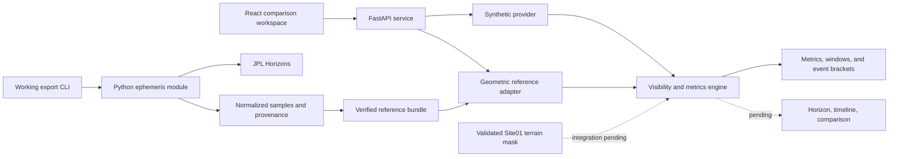

# Architecture

## Stack

The team plan separates Python/FastAPI data services from a React frontend. The existing frontend starter uses Next.js App Router and strict TypeScript. The Ephemeris lead's package is under `backend/src/lunarwindow/ephemeris`; it is importable without invoking the CLI. FastAPI lives under `backend/src/lunarwindow/api`, with a reusable engine under `backend/src/lunarwindow/visibility`. The API supports synthetic demos and geometric evaluations of verified archived ephemerides. No database is required at this stage.

Python uses FastAPI/Pydantic for HTTP contracts, Uvicorn for serving, the standard library for retrieval/storage, and JSON Schema for the ephemeris handoff boundary. Offline tests use `unittest` and FastAPI's HTTP test client. Matplotlib and Rasterio are optional analysis/acquisition extras. The frontend uses Zod for scenario validation, Vitest for tests, and ESLint/Prettier for code quality.

The package manifest overrides the TypeScript ESLint parser's `minimatch` dependency to patched version 11.0.8 or later in that major, addressing GHSA-g3hv-75wg-m249. Remove this override once upstream tooling depends on a patched release. ESLint stays on version 9 for compatibility with the React plugin's declared peer range.

## Boundaries

- `backend/src/lunarwindow/ephemeris`: P1 coordinate/time validation, Horizons query construction, strict parsing, source archives, and JSON/CSV export.
- `backend/src/lunarwindow/api`: P3 FastAPI routes, contracts, errors, CORS, synthetic demos, and the reference-data evaluation adapter.
- `backend/src/lunarwindow/reference.py`: verified offline bundle/catalog loading and contained sampling-grid selection.
- `backend/src/lunarwindow/terrain`: the `TerrainMask` (`lunarwindow.terrain-mask.v1`) handoff contract, plus P2 LOLA downloads, DEM access with projection checks, ray-cast horizon profiles, curated catalog and region-point selection, verified run bundles, and a cached custom-coordinate service. Rasterio/pyshp are needed only for reading files (`gis` extra); the algorithm needs only numpy.
- `backend/src/lunarwindow/visibility`: input validation, circular horizon interpolation, disc states, duration-weighted metrics, merged windows, and event brackets; no HTTP, storage, or retrieval dependency.
- `backend/tests`: offline Python tests and small archived NASA response fixtures.
- `src/app`: UI entry points, layouts, metadata, and the frontend health endpoint. Keep scientific calculations out of page and route files.
- `src/features`: user-facing workflows. `scenarios` edits and evaluates the two reference scenarios; `analysis` holds the timeline, mission window finder, sky explorer, and their pure, tested calculation helpers.
- `src/lib/api-client.ts`: typed browser client for the FastAPI reference endpoints and structured error messages.
- `src/domain`: frontend types and schemas; `ephemeris.ts` mirrors the Python export contract and `evaluation.ts` describes synthetic and reference evaluation contracts.
- `src/server/providers`: reserved for an optional frontend proxy to the team backend; no active provider is configured.
- `data`: downloaded inputs and generated outputs. Keep source metadata and checksums; ignore bulky data by default.
- `scripts`: reproducible acquisition and preprocessing commands.
- `tests`: frontend scenario contract tests.

## Current behavior

The page loads `GET /api/reference/sites`, then evaluates two scenarios (site, whole-day UTC period inside the archive, sampling step, visibility rule) with `POST /api/reference/evaluations`. Inputs are validated in the browser first; loading, error, and stale-result states are explicit, and API failures are shown rather than replaced with synthetic data. Results drive a shared-cursor timeline, a mission window finder, and a 2D sky explorer (`src/features/analysis`). Reloading resets the scenarios. `GET /api/health` describes this frontend process and identifies its ephemeris provider as `not-configured`; it does not check the separate Python CLI.

FastAPI runs separately on port 8000. `POST /api/evaluations` supplies synthetic scenarios (`lunarwindow.evaluation.v2`). The reference catalog and ephemeris endpoints expose the verified archive, and `POST /api/reference/evaluations` calculates geometric visibility from selected real samples (`lunarwindow.reference-evaluation.v1`). Responses include source labels, a horizon, pointing series, metrics, windows, and setting brackets. Reference evaluations require `horizonMode: "geometric"` and retain original NASA evidence plus full archive coverage. The React workspace uses the reference endpoints. See [the backend contract](backend-data.md) and [calculation model](visibility.md).

The CLI retrieves real Sun/Earth angles, caches provider responses, and exports flat series plus provenance. The committed 30-day dataset covers three sourced NASA LOLA reference grid cells, including surface heights. The reference adapter validates that bundle, selects its requested grid, and supplies a zero-degree horizon to the engine. QuickMap camera-observer comparisons are documented in `docs/validation/report.md`; they validate displayed angles for observers about 100–144 km up, not ground-level terrain shadows. One validated terrain mask (`data/reference/terrain-masks/lola-site01-reference-mast-0m.json`, contract `lunarwindow.terrain-mask.v1`) matches the archived Site01 ephemeris observer; the API does not load it yet. Horizons for the other curated sites are preliminary (see `docs/terrain-gis-lead.md`). Team-approved mission coordinates and the full multi-year dataset remain pending.

## Current data flow



The workspace, FastAPI service, visibility engine, Python ephemeris module, and export CLI exist today. The ephemeris type is `EphemerisDataset` in `src/domain/ephemeris.ts`; evaluation responses use `EvaluationDataset` or `ReferenceEvaluationDataset` in `src/domain/evaluation.ts`. Dashed arrows describe work still pending.

## HTTP contract

FastAPI implements `POST /api/evaluations` using the existing UI `Scenario` request:

```json
{
  "name": "Scenario A",
  "location": {
    "latitudeDeg": -89,
    "longitudeDeg": 0,
    "altitudeKm": 0
  },
  "startUtc": "2026-11-14T00:00:00Z",
  "endUtc": "2026-11-15T00:00:00Z",
  "stepMinutes": 60
}
```

The synthetic provider generates demo angles and masks. The reference endpoint instead accepts a catalog `siteId`, UTC range/step, and explicit geometric mode. Both use the shared engine and optional `visibilityRule`/`asOfUtc` controls. The reference path preserves P1 source evidence, validates archive-grid availability, and returns structured 404/422/503 errors without a synthetic fallback. GIS integration will supply verified masks and their provenance later.

The Python client bounds/chunks requests, uses timeouts and limited retries, validates observer coordinates, and reuses disk archives keyed by URL. Cooperating export workers share OS locks, honor Retry-After, and publish complete checksummed bundles. Evaluation requests are bounded to 31 days / 10,000 samples. The synchronous reference route runs disk reads and calculations in FastAPI's worker thread and makes no NASA requests. Live on-demand retrieval will need worker scheduling and cache-retention controls; cooperating retrieval workers must share the configured lock directory.

## Build and hosting

`npm run build` creates the Next.js production output; `npm start` serves it on port 3000. `pip install -e ./backend` installs the Python package, API dependencies, and CLI. `python -m uvicorn lunarwindow.api.app:app --port 8000` starts FastAPI. Docker Compose starts both services; CI checks service health, archived data, and reference evaluation. Python tests run separately in CI. Connecting the frontend remains a later integration task.
